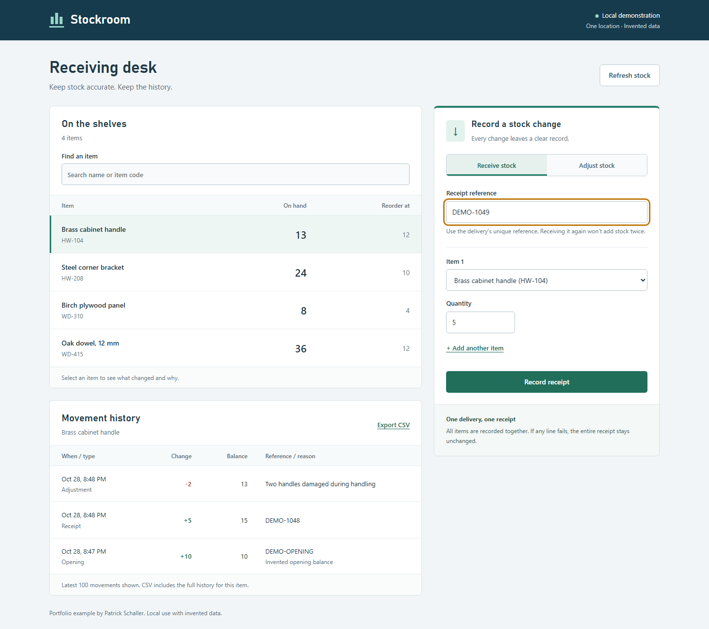
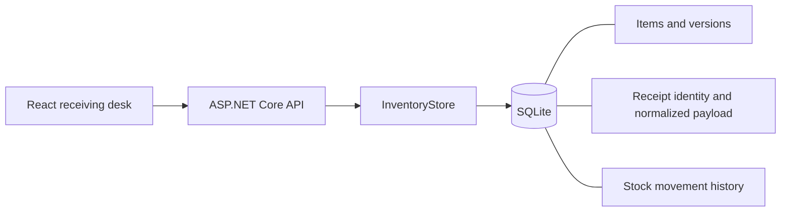

# Inventory Receiving

[](https://github.com/PatrickSchaller/inventory-receiving/actions/workflows/checks.yml)

A small .NET and React application for receiving stock, recording corrections, and explaining how an item's balance changed.

The interesting part is what happens when a delivery is submitted twice, one line is invalid, or two people try to correct the same stock. Those cases are exercised against a real SQLite database.

This is an independent portfolio demonstration with invented data. It is intended for local use, not a production inventory system.



[Watch the recorded walkthrough](docs/receiving-walkthrough.webm), including a duplicate receipt, a conflicting reference, and a stock correction. [Phone screenshot](docs/receiving-mobile.png).

## Run locally

Requirements: the latest patched .NET 10 SDK and Node.js 22.12 or newer within the Node 22 release line, or a newer supported Node LTS version.

From the repository directory:

```sh
cd client
npm ci
npm run build
cd ..
dotnet run --project src/Receiving.Api --no-launch-profile
```

Open **http://127.0.0.1:5087**. The API serves the built client from the same origin. The first run creates a local SQLite database and four invented items; subsequent runs keep the existing stock and history.

For React development, run the API in one terminal and `npm run dev` from `client` in another. Open http://127.0.0.1:5187; Vite proxies `/api` to the local API.

## Try the important behavior

1. Receive 5 brass cabinet handles (`HW-104`) using reference `DELIVERY-1048`.
2. Submit the same receipt again. The app reports that it was already received; stock stays unchanged.
3. Change the quantity to 6 while keeping that reference. The app reports a conflict.
4. Switch to **Adjust stock**, enter `-2`, and provide a reason. A new movement records the correction; the receipt remains visible.
5. Try an adjustment larger than the available stock. It is rejected.
6. Export the movement history as CSV.

The sample starts with 10 brass handles. Completing the valid receipt and correction leaves 13. These are demonstration results, not measured savings from a business deployment.

## Verify

From the repository directory:

```sh
dotnet restore InventoryReceiving.slnx --locked-mode
dotnet test InventoryReceiving.slnx --no-restore
cd client
npm ci
npm run build
npx playwright install chromium
npm test
```

Stop manually running API and Vite processes before the browser tests; they start their own servers on ports 5087 and 5187 and use a separate database. The tests do not reset the normal demo database.

- **18 API/database tests:** durable receipt replay, canonical receipt identity, payload conflicts, all-or-nothing receipts, input validation, balance limits, concurrent writes, stale adjustments, CSV safety, complete exports, and write-request validation.
- **2 Chromium tests:** the receiving/correction/export flow with desktop and phone layouts, and an unavailable-service state. They also check for uncaught page errors and page overflow in the main workflow.
- TypeScript checks and a production client build.

The included GitHub Actions workflow runs these commands on Linux. See [the validation record](docs/validation.md) for what was actually checked and the local test-environment limits.

## Design



There is one API project and one database class, with parameterized SQL. No generic repository, message broker, background worker, or distributed cache is needed for this workflow.

**Receipts:** references and item codes are trimmed and uppercased; receipt lines are sorted by item code before comparing payloads. A durable primary key makes receipt references unique. An immediate SQLite transaction obtains the writer lock before checking receipt identity. Stock changes, movements, and the receipt record commit together. Replaying the same normalized payload returns the original receipt timestamp without adding stock. A different payload under the same reference returns HTTP 409.

**Corrections:** the client submits the stock version it loaded. A correction with a stale version is rejected. Applying a change increments that version, and a correction adds a movement rather than editing the old movement. Repeating a correction with the old version cannot apply it twice.

**Concurrency:** each operation opens its own connection. SQLite serializes writers; the transaction protects the read/check/write sequence, and an explicit version check protects corrections based on stale screens. Lock waits are bounded to five seconds; a busy database returns HTTP 503 with a retry hint.

**Bounds:** quantities are whole units. Receipts contain 1–20 unique items with 1–100,000 units each. Corrections are nonzero changes from -100,000 to 100,000. A final balance must remain between 0 and 1,000,000, with a database constraint backing the application check.

**Exports:** the screen shows the latest 100 movements for an item; CSV includes its full history. Text is quoted, embedded quotes are escaped, and formula-like text is prefixed with an apostrophe for spreadsheet safety. Numeric changes remain numeric. Timestamps are stored in UTC and displayed in the browser's local time.

Read [the code walkthrough](docs/code-walkthrough.md) for the main paths and useful questions to review.

## API

| Method | Path | Behavior |
| --- | --- | --- |
| GET | `/api/items` | Item balances, reorder points, and versions |
| GET | `/api/movements?sku=HW-104` | Latest 100 movements; omit `sku` for all items |
| GET | `/api/movements/export?sku=HW-104` | Download the full matching history |
| POST | `/api/receipts` | Apply a receipt or safely identify a replay |
| POST | `/api/adjustments` | Apply a correction using the expected version |

Write requests use JSON and the header `X-Inventory-Client: stockroom`. That header is a request-intent check against cross-site browser writes, not authentication. CORS is not enabled. The server binds to loopback, rejects non-loopback clients, and restricts allowed host names.

Example receipt body:

```json
{
  "reference": "DELIVERY-1048",
  "lines": [{ "sku": "HW-104", "quantity": 5 }]
}
```

Example correction body, using the version returned by `GET /api/items`:

```json
{
  "sku": "HW-104",
  "delta": -2,
  "expectedVersion": 1,
  "reason": "Two handles damaged during handling"
}
```

Errors return Problem Details with an actionable `detail`. An uncertain save should be followed by a refresh and history review. The same receipt can be retried safely; corrections use the original expected version to prevent applying an uncertain change twice.

## Data, backup, and reset

The default database is `src/Receiving.Api/data/inventory.db` when run using the documented project command. Database files, build output, and installed packages are excluded from Git.

To preserve a demo, stop the API and copy the entire `data` directory to a backup location. Do not copy only a live `.db` file while SQLite's write-ahead log may contain changes.

To reset, stop the API, rename its `data` directory, and start it again. For example, from the repository root in PowerShell, when `data.backup` does not already exist:

```powershell
Rename-Item -LiteralPath ./src/Receiving.Api/data -NewName data.backup
```

The original data remains in `data.backup`. To restore it, stop the API and put the saved directory back in place of the current `data` directory, preserving the current directory elsewhere first. A custom path can be supplied through the standard .NET configuration key `Inventory:DatabasePath`, or environment variable `Inventory__DatabasePath`.

## Limits

One location, a seeded catalog, and whole units. No purchasing, accounting, barcode hardware, external ERP connection, user accounts, or actor attribution. Movement history is preserved through the application's API; it is not a tamper-resistant audit log against someone who can edit the database file.

Authentication, authorization, operational backups, and a broader deployment review are required before considering shared or public hosting with real data. The current access checks intentionally keep this a local demonstration.

## Development disclosure

The initial implementation was prepared with Codex assistance. It uses original sample code and invented records, with design decisions and automated checks documented for review. It does not represent a client deployment or published employer work.

## License

MIT. See [LICENSE](LICENSE).
